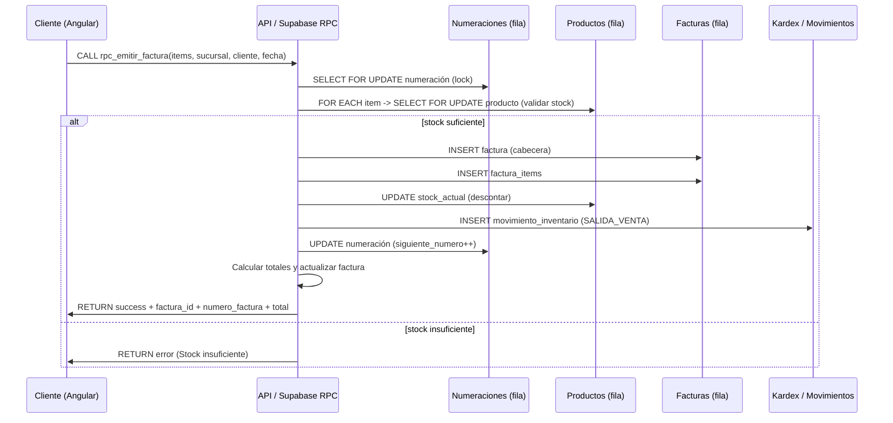

# FacturaPro 360 — Suite de Facturación e Inventario (Edición Web + Escritorio)

Arquitectura dual (Offline Desktop + SaaS Web) diseñada para comercios y pymes que necesitan:
- Operar en modo local (sin internet) con garantías ACID y respaldo, y/o
- Escalar a multiempresa (SaaS) con aislamiento por tenant, políticas RLS y transacciones seguras en la base de datos.

Este README explica por qué se creó el proyecto, cómo está organizado, cómo desplegarlo y contiene diagramas arquitectónicos completos (topología de despliegue, componentes, flujo de datos y esquema lógico de DB) para facilitar operaciones, auditoría y extensión.

---

## Índice
1. Motivo y objetivo
2. Características principales
3. Stack tecnológico
4. Diagramas (despliegue, componentes, secuencia, ER)
5. Organización del repositorio
6. Flujo MVP implementado
7. Instrucciones rápidas: ejecutar local y con Docker
8. Seguridad, multi-tenant y políticas RLS
9. RPCs transaccionales clave (resumen)
10. Pruebas y observabilidad
11. Cómo contribuir
12. Contacto y licencia

---

## 1) Motivo y objetivo
FacturaPro 360 nace para cubrir la brecha entre soluciones locales simples y plataformas empresariales complejas: una suite que puede correr completamente offline en una estación de trabajo o como SaaS multitenant con aislamiento riguroso y transacciones atómicas en la base de datos.

Objetivos:
- Integridad contable e inventarios (ACID).
- Aislamiento de datos por tenant (RLS + validaciones).
- Despliegue reproducible (Docker Compose).
- UX moderna y control operacional (Desktop + Web).

---

## 2) Características principales
- Módulos: Clientes, Productos/Inventario (Kardex), Facturación, Pagos, Anulación, Dashboard y Auditoría.
- Numeración segura (SELECT FOR UPDATE).
- RPCs transaccionales en PostgreSQL para emitir/pagar/anular facturas.
- Aislamiento por `empresa_id` y políticas RLS.
- Desktop (.NET 8 + WPF) y Web (Angular + Supabase).
- Contenedores listos para producción (Nginx + Postgres).

---

## 3) Stack (resumen)
- Lenguajes: TypeScript, C#, PL/pgSQL.
- Frontend: Angular (Standalone Components, Signals), Tailwind CSS.
- Desktop: .NET 8, WPF, MVVM, EF Core 8.
- DB: PostgreSQL 15+ (Supabase, migraciones incluidas).
- Contenedores: Docker Compose (web + postgres).
- Notables: EF Core 8, jsPDF, CommunityToolkit.Mvvm.

---

## 4) Diagramas y arquitectura (detallados)

A continuación hay 4 diagramas que explican en detalle la arquitectura y los flujos críticos. Abajo de cada diagrama hay una breve explicación y decisiones de diseño.

### 4.1) Diagrama de despliegue (topología: entornos on-prem / cloud + contenedores)
```mermaid
flowchart LR
  %% Deployment diagram: nodes and network topology
  subgraph USER_SIDE [Usuarios y Clientes]
    A[Usuario Web\n(Navegador)] 
    B[Usuario Desktop\n(PC/Terminal)]
  end

  subgraph ON_PREM [Modo Local (Desktop)]
    B --> DSK_APP[FacturaPro360 Desktop\n(.NET 8 + WPF)]
    DSK_APP --> DSK_DB[(SQLite / SQL Server Express)]
    DSK_APP --> FILESYS[Archivos locales & Backups (.bak)]
  end

  subgraph CLOUD_SAAS [Modo SaaS / Producción]
    A --> CDN[CDN / Nginx (servir SPA)]
    CDN --> WEB_APP[Angular SPA (static)]
    WEB_APP --> SUPABASE[Supabase / PostgreSQL (RPCs, RLS)]
    SUPABASE --> PG_DATA[(Postgres Data)]
    SUPABASE --> AUDIT[(Auditorías / Logs)]
    CDN -.-> AUTH[Auth Provider (Supabase/Auth)]
  end

  subgraph INFRA [Infra]
    DOCKER_HOST[Docker Host / VM / Kubernetes Node]
    DOCKER_HOST -->|docker-compose| CDN
    DOCKER_HOST --> SUPABASE
  end

  style CLOUD_SAAS fill:#f4f7ff,stroke:#a6b8ff
  style ON_PREM fill:#fffaf0,stroke:#ffd18f
  style INFRA fill:#eef9f1,stroke:#8fe3a1
```

Explicación:
- El despliegue Cloud empaqueta el frontend estático servido por Nginx (o CDN) y una instancia de Postgres (Supabase) que ejecuta RPCs y aplica RLS.
- El modo Desktop es autónomo: ejecuta la lógica en .NET y persiste localmente (SQLite o SQL Server Express) con posibilidad de exportar backups.
- Docker Compose incluido permite levantar web + postgres localmente para pruebas y despliegue sencillo.

### 4.2) Diagrama de componentes (lógica, módulos y responsabilidades)
```mermaid
graph TD
  %% Component diagram: modules and interactions
  UI_WEB[Angular SPA\n(Components, Services)]
  UI_DESK[WPF Desktop\n(Views, ViewModels)]
  SHARED[Shared Domain\n(Entidades, DTOs)]
  RPCS[Postgres RPCs\n(rpc_emitir_factura, rpc_registrar_pago, rpc_anular_factura)]
  DB[(Postgres / Supabase)]
  EFCORE[EF Core DbContext\n(Desktop)]
  BACKUPS[Backups / Reports]
  AUDIT[Auditorías (immutable)]
  AUTH[Auth Service / Roles]

  UI_WEB -->|LLama RPC| RPCS
  UI_WEB -->|Auth| AUTH
  UI_DESK -->|EF Core| EFCORE
  EFCORE -->|DB local| DB
  RPCS --> DB
  RPCS --> AUDIT
  EFCORE --> BACKUPS
  SHARED --> UI_WEB
  SHARED --> UI_DESK

  classDef infra fill:#f0f8ff,stroke:#7aa2ff;
  class DB,RPCS,AUDIT infra
```

Explicación:
- UI_Web invoca RPCs en la base de datos para garantizar atomicidad en operaciones críticas.
- Desktop usa EF Core para aplicar las mismas reglas de negocio localmente (mismo modelo).
- Auditoría centralizada en DB garantiza trazabilidad.

### 4.3) Diagrama de secuencia (emitir factura — flujo transaccional)


Explicación:
- El bloqueo de numeración y productos evita condiciones de carrera y asegura consecutivos sin huecos.
- Todo corre dentro de la función RPC para mantener la atomicidad en el motor DB.

### 4.4) Diagrama lógico / ER simplificado (tablas clave)
```mermaid
erDiagram
  EMPRESAS {
    UUID id PK "empresa_id"
    string nombre
    string slug
    ...
  }
  USUARIOS {
    UUID id PK "usuario_id"
    UUID empresa_id FK
    string email
    ...
  }
  CLIENTES {
    UUID id PK
    UUID empresa_id FK
    numeric saldo_actual
    ...
  }
  PRODUCTOS {
    UUID id PK
    UUID empresa_id FK
    numeric stock_actual
    boolean permite_stock_negativo
    ...
  }
  FACTURAS {
    UUID id PK
    UUID empresa_id FK
    UUID cliente_id FK
    string numero_factura
    numeric total
    numeric saldo_pendiente
    string estado
    ...
  }
  FACTURA_ITEMS {
    UUID id PK
    UUID factura_id FK
    UUID producto_id FK
    numeric cantidad
    numeric precio_unitario
    numeric impuesto
    ...
  }
  PAGOS {
    UUID id PK
    UUID factura_id FK
    numeric monto
    string idempotency_key
    ...
  }
  MOVIMIENTOS_INVENTARIO {
    UUID id PK
    UUID producto_id FK
    UUID empresa_id FK
    string tipo
    numeric cantidad
    ...
  }
  AUDITORIAS {
    UUID id PK
    UUID empresa_id FK
    UUID usuario_id FK
    string modulo
    string accion
    jsonb datos_nuevos
    ...
  }

  EMPRESAS ||--o{ USUARIOS : "tiene"
  EMPRESAS ||--o{ CLIENTES : "pertenece"
  EMPRESAS ||--o{ PRODUCTOS : "pertenece"
  CLIENTES ||--o{ FACTURAS : "recibe"
  FACTURAS ||--o{ FACTURA_ITEMS : "contiene"
  FACTURAS ||--o{ PAGOS : "recibe"
  PRODUCTOS ||--o{ MOVIMIENTOS_INVENTARIO : "genera"
  EMPRESAS ||--o{ AUDITORIAS : "registra"
```

Explicación:
- El ER destaca las relaciones por `empresa_id` para imponer aislamiento lógico y facilidad de políticas RLS.
- Observa `idempotency_key` en `pagos` para evitar duplicados por reintentos.

---

## 5) Organización del repositorio (resumen)
```
SAAS/
├── FacturaPro360-Desktop/        # Desktop (.NET 8 + WPF) + tests xUnit
│   ├── src/ (Domain, Application, Infrastructure, Wpf)
│   └── tests/
├── FacturaPro360-Web/            # Angular + Supabase migrations (001..004)
│   ├── src/ (app: components, services, models)
│   └── supabase/migrations/
├── docker-compose.yml
├── DOCUMENTACION_SISTEMA.md
├── MANUAL_USUARIO_FACTURAPRO360.pdf
└── docs/
```

---

## 6) Flujo MVP implementado (resumen)
- Registro de empresa/usuario (wizard 4 pasos).
- Catálogo de productos, inventario con kardex.
- Emisión de facturas con consecutivo seguro y cálculos exactos.
- Registro de pagos (idempotencia) y anulación (reversión atómica).
- Auditoría inmutable y métricas del tenant.

---

## 7) Instrucciones rápidas (recordatorio)
### 7.1. Levantar con Docker (recomendado)
```bash
docker compose up -d --build
# Frontend: http://localhost:8080/
# Postgres: localhost:5432
```

### 7.2. Levantar Web en desarrollo
```bash
cd FacturaPro360-Web
cp .env.example .env
npm install
npm start
```

### 7.3. Ejecutar Desktop (Windows)
```powershell
dotnet build FacturaPro360-Desktop/FacturaPro360.sln
dotnet run --project FacturaPro360-Desktop/src/FacturaPro360.Wpf/FacturaPro360.Wpf.csproj
```

### 7.4. Migraciones Supabase (orden)
1. 001_initial_schema.sql
2. 002_rls_policies.sql
3. 003_rpc_transactions.sql
4. 004_seed_data.sql

---

## 8) Seguridad y multi-tenant
- RLS aplicado: `USING (empresa_id = public.get_auth_empresa_id())`.
- Validación server-side del `empresa_id` en RPCs y consultas.
- IDOR mitigado por comprobación explícita de `empresa_id`.
- Idempotencia para pagos (campo `idempotency_key`).
- Auditoría inmutable para trazabilidad forense.

---

## 9) RPCs transaccionales (resumen técnico)
- `rpc_emitir_factura(...)`: bloqueo numeración, validación stock, inserción factura/items, actualización stock y kardex, auditoría. Devuelve JSONB con totales y número.
- `rpc_registrar_pago(...)`: idempotencia, bloqueo factura, validar sobrepagos, insertar pago, actualizar saldo y estado, auditoría.
- `rpc_anular_factura(...)`: bloqueo factura, revertir stock y kardex, ajustar saldos, marcar factura como anulada, auditoría.

---

## 10) Pruebas, observabilidad y calidad
- Tests: xUnit (Desktop), scripts Node para pruebas multitenant (16/16 tests pasados en auditoría).
- Auditorías: tabla `auditorias`.
- Logs y métricas: generar por integración con el host (opcional: Prometheus / Grafana).
- Recomendación: programar backups regulares (pg_dump / .bak) y testear recuperación.

---

## 11) Cómo contribuir
1. Abrir issue describiendo objetivo o bug.
2. Crear rama `feat/xxx` o `fix/xxx`.
3. Agregar tests (xUnit / unit/e2e).
4. PR con descripción, screenshots y checklist de pruebas.

---

## 12) Contacto y licencia
- Maintainer: ver DOCUMENTACION_SISTEMA.md para detalles de equipo.
- Añadir LICENSE (MIT/Apache2) según preferencia del repositorio.

---

Gracias por usar FacturaPro 360. Si quieres, puedo:
- Generar una versión resumida para la landing page o README en inglés.
- Crear PNG/SVG a partir de los diagramas Mermaid y los añada a `/docs/images`.
- Preparar una versión simplificada (landing page) en inglés o una versión más corporativa para presentación.

