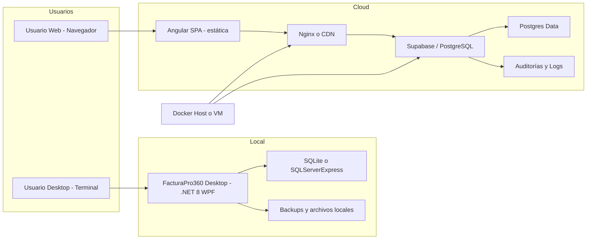
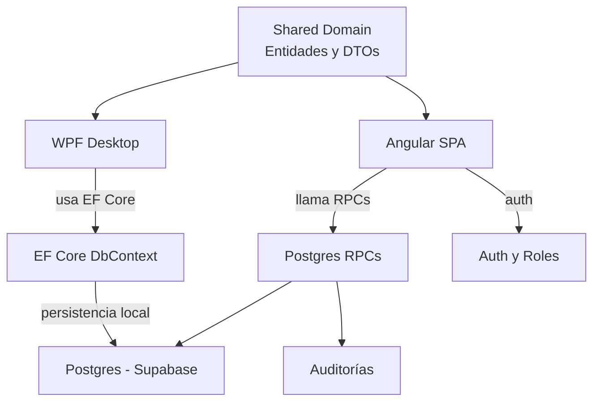
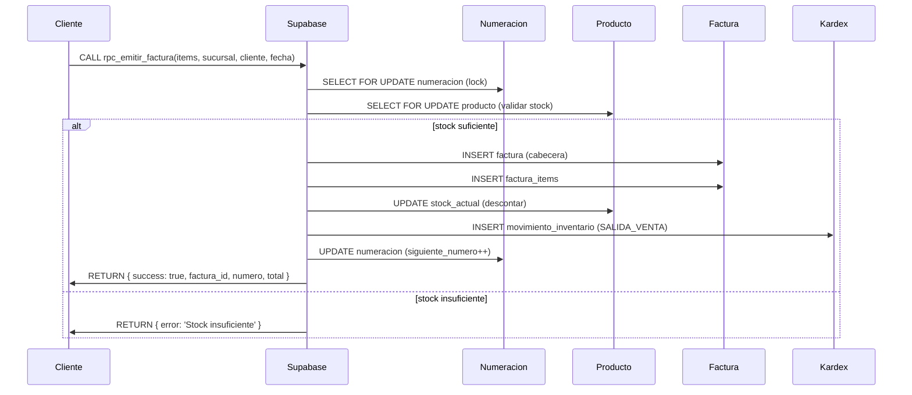
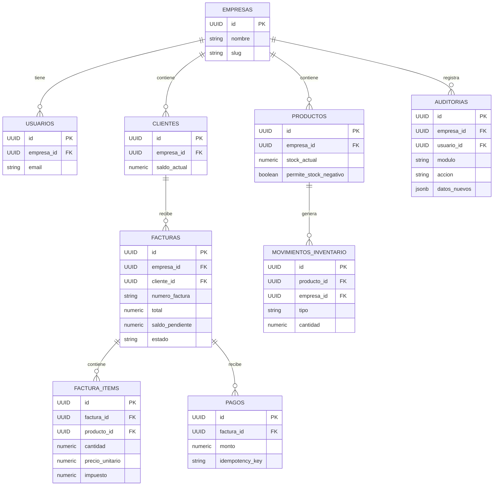

# 🧾 FacturaPro 360 — Suite de Facturación e Inventario (Web + Escritorio)

Arquitectura dual (Offline Desktop + SaaS Web) para comercios y pymes:
- Local (sin internet) con garantías ACID y respaldo.
- SaaS multiempresa con aislamiento por tenant (RLS) y RPCs transaccionales.

Este README incluye motivo, arquitectura, diagramas compatibles con GitHub, iconos por sección y enlaces a la documentación contenida en este repositorio.

---

## Índice
1. 🧭 Motivo y objetivo
2. ✨ Características principales
3. 🛠️ Stack tecnológico
4. 🏗️ Arquitectura y diagramas (compatibles GitHub)
5. 📁 Organización del repositorio
6. 🔁 Flujo MVP implementado
7. 🚀 Instrucciones rápidas (Docker / Dev / Desktop)
8. 🔒 Seguridad y multi-tenant (RLS)
9. 🗃️ RPCs transaccionales clave
10. ✅ Pruebas y observabilidad
11. 🤝 Cómo contribuir
12. 📄 Documentación relacionada y licencia

---

## 1) 🧭 Motivo y objetivo
FacturaPro 360 nace para ofrecer una plataforma profesional de facturación e inventario que pueda operar:
- Localmente (estación de trabajo / terminales) con integridad transaccional, o
- En la nube como servicio multiempresa con aislamiento estricto y trazabilidad.

Objetivos:
- Integridad contable e inventarios (ACID).
- Aislamiento por tenant (RLS + validaciones en BD).
- Despliegue reproducible (Docker Compose).
- UX moderna y control operacional (Desktop + Web).

---

## 2) ✨ Características principales
- Módulos: Clientes, Productos/Inventario (Kardex), Facturación, Pagos, Anulación, Dashboard y Auditoría.
- Numeración segura (bloqueos SELECT FOR UPDATE dentro de RPCs).
- RPCs transaccionales en PostgreSQL para emitir/pagar/anular facturas.
- Aislamiento por `empresa_id` y políticas RLS.
- Desktop (.NET 8 + WPF, MVVM) y Web (Angular + Supabase).
- Despliegue contenedorizado con Nginx + Postgres listo para producción.

---

## 3) 🛠️ Stack tecnológico (resumen)
- Lenguajes: TypeScript (Angular), C# (.NET 8), PL/pgSQL (migraciones/RPC).
- Frontend: Angular (Standalone Components, Signals), Tailwind CSS.
- Desktop: .NET 8, WPF, CommunityToolkit.Mvvm, EF Core 8.
- DB: PostgreSQL 15+ (Supabase migrations incluidas).
- Contenedores: Docker Compose (web + postgres).
- Notables: jsPDF (PDF cliente), idempotency en pagos, auditoría inmutable.

---

## 4) 🏗️ Arquitectura y diagramas (compatibles con GitHub)
A continuación diagramas revisados para GitHub (evitando caracteres problemáticos en etiquetas). Si quieres imágenes PNG/SVG con los mismos diagramas, puedo generarlas y subirlas a `/docs/images`.

### 4.1) Diagrama de despliegue (topología)


Explicación: frontend estático servido por Nginx o CDN; Supabase/PG ejecuta RPCs y aplica RLS; modo Desktop funciona autónomo y genera backups.

### 4.2) Diagrama de componentes (módulos y responsabilidades)


### 4.3) Diagrama de secuencia (emitir factura)


### 4.4) Diagrama lógico / ER (tablas clave)


---

## 5) 📁 Organización del repositorio
```
SAAS/
├── FacturaPro360-Desktop/
│   ├── src/ (Domain, Application, Infrastructure, Wpf)
│   └── tests/ (xUnit)
├── FacturaPro360-Web/
│   ├── src/ (app: components, services, models)
│   └── supabase/migrations/ (001..004)
├── docker-compose.yml
├── DOCUMENTACION_SISTEMA.md
├── MANUAL_USUARIO_FACTURAPRO360.pdf
└── docs/
```

Enlaces directos importantes en este repo:
- 📘 Documentación técnica: [DOCUMENTACION_SISTEMA.md](./DOCUMENTACION_SISTEMA.md)
- 📄 Manual de usuario (PDF): [MANUAL_USUARIO_FACTURAPRO360.pdf](./MANUAL_USUARIO_FACTURAPRO360.pdf)
- 🐘 Migraciones Supabase: [FacturaPro360-Web/supabase/migrations](./FacturaPro360-Web/supabase/migrations)
- 🐳 Docker Compose: [docker-compose.yml](./docker-compose.yml)
- 🖥️ Desktop README: [FacturaPro360-Desktop/README.md](./FacturaPro360-Desktop/README.md)
- 🌐 Web README: [FacturaPro360-Web/README.md](./FacturaPro360-Web/README.md)

---

## 6) 🔁 Flujo MVP implementado (resumen)
- Registro de empresa/usuario (wizard 4 pasos).
- Catálogo de productos y control Kardex.
- Emisión de facturas con consecutivo seguro.
- Registro de pagos (idempotencia) y anulación (reversión atómica).
- Auditoría inmutable y métricas por tenant.

---

## 7) 🚀 Instrucciones rápidas
### Levantar con Docker (recomendado)
```bash
docker compose up -d --build
# Frontend: http://localhost:8080/
# Postgres: localhost:5432
```

### Desarrollo Web (sin Docker)
```bash
cd FacturaPro360-Web
cp .env.example .env
npm install
npm start
```

### Ejecutar Desktop (Windows)
```powershell
dotnet build FacturaPro360-Desktop/FacturaPro360.sln
dotnet run --project FacturaPro360-Desktop/src/FacturaPro360.Wpf/FacturaPro360.Wpf.csproj
```

### Migraciones Supabase (orden)
1. FacturaPro360-Web/supabase/migrations/001_initial_schema.sql
2. FacturaPro360-Web/supabase/migrations/002_rls_policies.sql
3. FacturaPro360-Web/supabase/migrations/003_rpc_transactions.sql
4. FacturaPro360-Web/supabase/migrations/004_seed_data.sql

---

## 8) 🔒 Seguridad y multi-tenant
- RLS: `USING (empresa_id = public.get_auth_empresa_id())` en tablas sensibles.
- Prevención de IDOR con verificaciones server-side del `empresa_id`.
- Idempotencia en pagos: `idempotency_key`.
- Auditoría inmutable en tabla `auditorias`.

---

## 9) 🗃️ RPCs transaccionales (clave)
- `rpc_emitir_factura(...)` — bloqueo numeración, validación stock, inserción de factura y items, actualización de stock, kardex y auditoría.
- `rpc_registrar_pago(...)` — idempotencia, bloqueo factura, insertar pago, actualizar saldo y estado.
- `rpc_anular_factura(...)` — bloqueo factura, revertir stock y kardex, marcar factura como anulada.

Consulta el SQL de las funciones: `FacturaPro360-Web/supabase/migrations/003_rpc_transactions.sql`.

---

## 10) ✅ Pruebas y observabilidad
- Tests: xUnit (Desktop) y scripts Node para pruebas multitenant.
- Auditorías para trazabilidad.
- Recomendación: backups regulares (pg_dump/.bak) y monitoreo.

---

## 11) 🤝 Cómo contribuir
1. Abrir un Issue describiendo objetivo o bug.
2. Crear rama `feat/xxx` o `fix/xxx`.
3. Añadir tests (xUnit / unit/e2e).
4. Abrir Pull Request con descripción y checklist.

---

## 12) 📄 Documentación relacionada y licencia
- Documentación técnica: [DOCUMENTACION_SISTEMA.md](./DOCUMENTACION_SISTEMA.md)
- Manual usuario: [MANUAL_USUARIO_FACTURAPRO360.pdf](./MANUAL_USUARIO_FACTURAPRO360.pdf)

Si quieres, puedo:
- Generar PNG/SVG para los diagramas Mermaid y subirlos a `/docs/images` y reemplazar los bloques por imágenes (mejor render en vistas externas).
- Añadir un archivo LICENSE (por ejemplo MIT) y hacer commit.
- Crear un Pull Request en vez de commitear directo en main.

---

*Actualizado y validado para compatibilidad con el render Mermaid de GitHub.*
